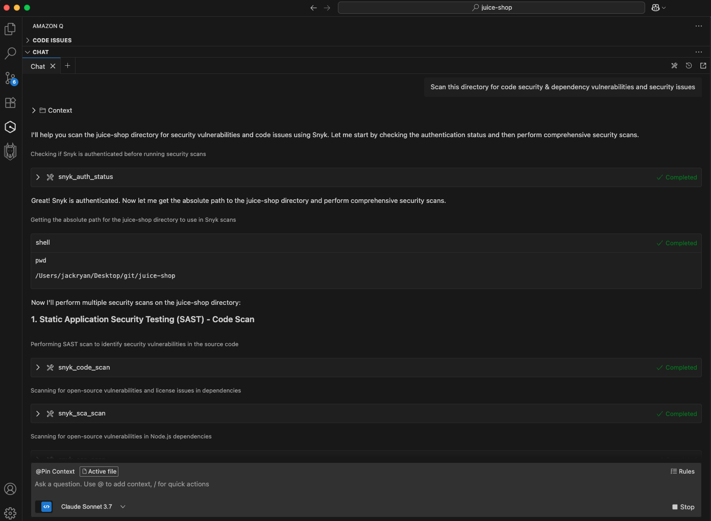

# Connect Amazon Q to Snyk


AWS plans to end support for the Amazon Q Developer IDE plugin on April 30, 2027. AWS recommends migrating to Kiro. Visit the [Amazon Q IDE end-of-support notice](https://docs.aws.amazon.com/amazonq/latest/qdeveloper-ug/q-developer-ide-end-of-support.html).


Connect Amazon Q to the local Snyk MCP server to scan code and dependencies from your coding assistant.


This setup provides MCP access. It does not install Studio Secure at inception hooks. Rules instruct the agent when to scan and depend on the model following those instructions.

For clients supported by the Studio CLI installer, use [Getting started with Snyk Studio](../getting-started-with-snyk-studio.md). For enterprise deployment, use the [Agentic Development Security (ADS) installer](../../evo-by-snyk/agentic-development-security-ads/activation-and-deployment/README.md).



## Prerequisites

* Install the code assistant extension
* [Install the Snyk CLI](https://docs.snyk.io/developer-tools/snyk-cli/install-the-snyk-cli)

Add the Amazon Q extension to your IDE. Visit the official [Installing the Amazon Q Developer extension or plugin in your IDE](https://docs.aws.amazon.com/amazonq/latest/qdeveloper-ug/q-in-IDE-setup.html).

## Install the Snyk MCP server in the Amazon Q IDE extension

You can configure the Snyk MCP server in VS Code and JetBrains for Amazon Q.

Using the AmazonQ extension UI in your chosen IDE:

1. Add a new MCP Server
2. Provide the following values in the specified fields:
   1. Command: `npx`
   2. Arguments: `-y snyk@latest mcp -t stdio -o=ostemp`
   3. Set a timeout supported by your IDE.

The `-o` option instructs the MCP server to write the scan results to a file. To direct the results to a specific folder, provide an absolute path instead of using `ostemp`. For example, `-o=/absolute/path/to/folder`


For additional MCP configuration options on Amazon Q and troubleshooting, visit the official [Amazon Q MCP server documentation](https://docs.aws.amazon.com/amazonq/latest/qdeveloper-ug/qdev-mcp.html).


## Set up the Snyk MCP server

Authenticate with Snyk and complete the client's trust request for the repository directory when prompted.

The assistant invokes the authentication and trust workflows. Complete any browser confirmation request.

<figure><figcaption></figcaption></figure>

If you need to authenticate and trust the current directory, then proceed and complete the process.

<figure><figcaption></figcaption></figure>

## Secure at inception rules

Add rules to guide the assistant when invoking Snyk scans. Rules do not guarantee that the model runs a scan. For the generic rule text, visit [Rules for manual MCP integrations](../directives.md#rules-for-manual-mcp-integrations).

Append the generic rule text to the rules file at `.amazonq/rules/amazonq-rules.md`. For details about project rules, visit the [Amazon Q Developer documentation](https://docs.aws.amazon.com/amazonq/latest/qdeveloper-ug/context-project-rules.html).

<figure><figcaption></figcaption></figure>

## Examples

In the chat, you can tag specific files or functions and ask Amazon Q to scan your code before deployment:


```text
Scan this directory for code security & dependency vulnerabilities and security issues
```


Amazon Q indicates that this request is related to security vulnerability scanning and calls the Snyk MCP server for various scans.

<figure><figcaption></figcaption></figure>

Amazon Q combines the code and dependency scan results with Snyk recommendations to suggest fixes for some or all of the findings.

<figure><figcaption></figcaption></figure>
