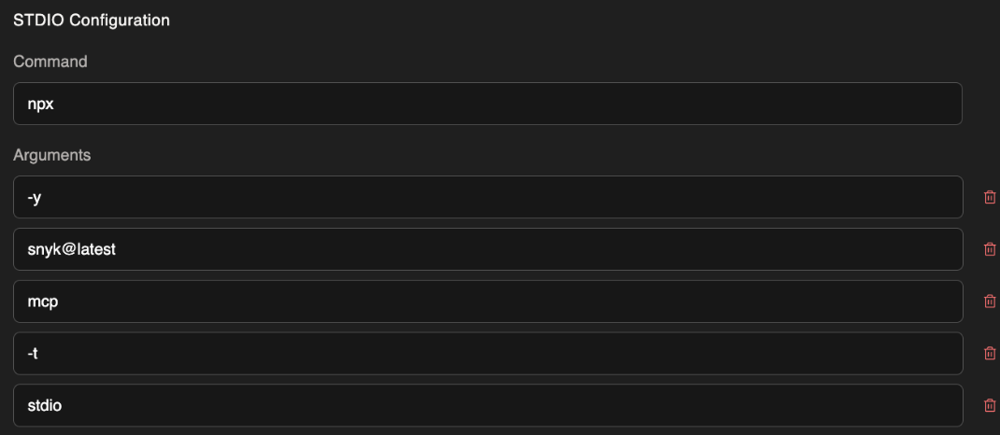
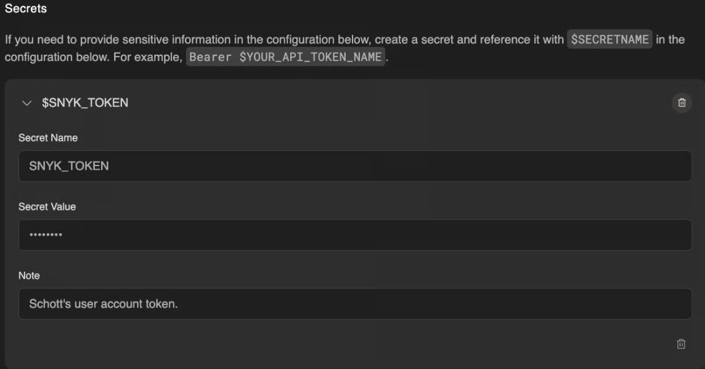
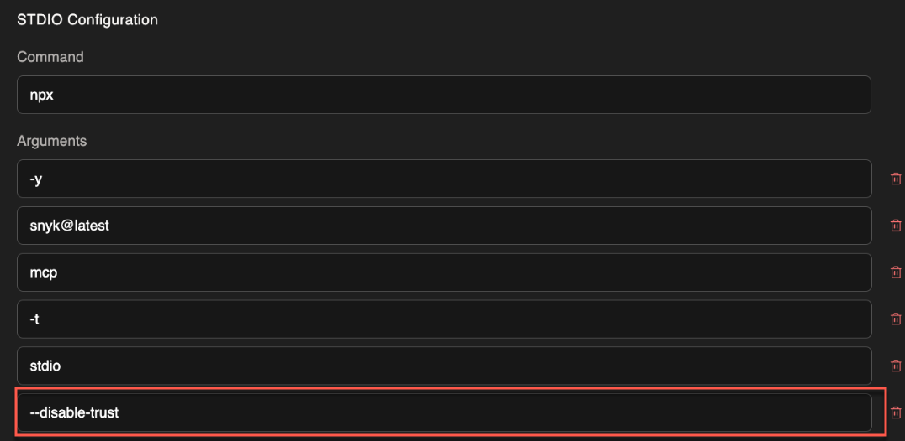

# Connect Devin to Snyk

Connect Devin to the Snyk MCP server to scan code and dependencies from a Devin cloud session. The MCP server runs in the Devin session environment, not on your workstation.


This setup provides MCP access. It does not install Studio Secure at inception hooks. Rules instruct the agent when to scan and depend on the model following those instructions.

For clients supported by the Studio CLI installer, use [Getting started with Snyk Studio](../getting-started-with-snyk-studio.md). For enterprise deployment, use the [Agentic Development Security (ADS) installer](../../evo-by-snyk/agentic-development-security-ads/activation-and-deployment/README.md).



## Prerequisites

* Get Started with Devin

Navigate to [Devin.ai](https://devin.ai/) to get started using the AI software engineer.

## Install the Snyk MCP server in Devin

Install the Snyk MCP server by navigating to **Settings** > **Organization settings** > **MCP marketplace** > **Add your own**.

The command to run the Snyk MCP server is `npx -y snyk@latest mcp -t stdio`. Add this command to your Devin configuration in the **STDIO Configuration** section, as shown in the following example.

<figure><figcaption></figcaption></figure>

Select **Add a new secret** and add your API token. To learn more, visit [How to obtain your personal token](https://docs.snyk.io/developer-tools/snyk-api/authentication-for-api#how-to-obtain-your-personal-access-token). You must use `SNYK_TOKEN` for the **Secret Name** and **Environment Variable** name.


Devin stores the token in the **Secret** and references it with `$SNYK_TOKEN`. Do not put your full Snyk token in the **Environment Variables** section.


<figure><figcaption></figcaption></figure>

Finally, you can optionally add the `--disable-trust` argument to the command, as shown in the following example.

<figure><figcaption></figcaption></figure>

The Snyk MCP server includes a folder trust mechanism that helps safeguard users from executing Snyk on untrusted code. To learn more, visit [Visual Studio workspace trust](https://docs.snyk.io/developer-tools/integrations/snyk-ide-plugins-and-extensions/visual-studio-extension/visual-studio-workspace-trust). Without this option, the Snyk MCP server opens a browser window to request trust for the repository directory. Devin handles the request through its built-in browser. Add `--disable-trust` only if you want to skip the folder-trust workflow.

## Secure at inception rules

Add rules to [Devin Knowledge](https://docs.devin.ai/product-guides/knowledge) to guide the assistant when it invokes Snyk scans. Rules do not guarantee that the model runs a scan. For the generic rule text, visit [Rules for manual MCP integrations](../directives.md#rules-for-manual-mcp-integrations).

Add the generic rule text to Devin Knowledge.

<figure><figcaption></figcaption></figure>

## Examples

In the chat, you can tag specific files or functions and ask Devin to scan your code before deployment:


```text
Scan this directory for code security & dependency vulnerabilities security issues
```


Check the tool calls to confirm that Devin invoked the requested Snyk MCP scans.

Devin combines the code and dependency scan results with Snyk recommendations to suggest fixes for some or all of the findings.

<figure><figcaption></figcaption></figure>

<figure><figcaption></figcaption></figure>
