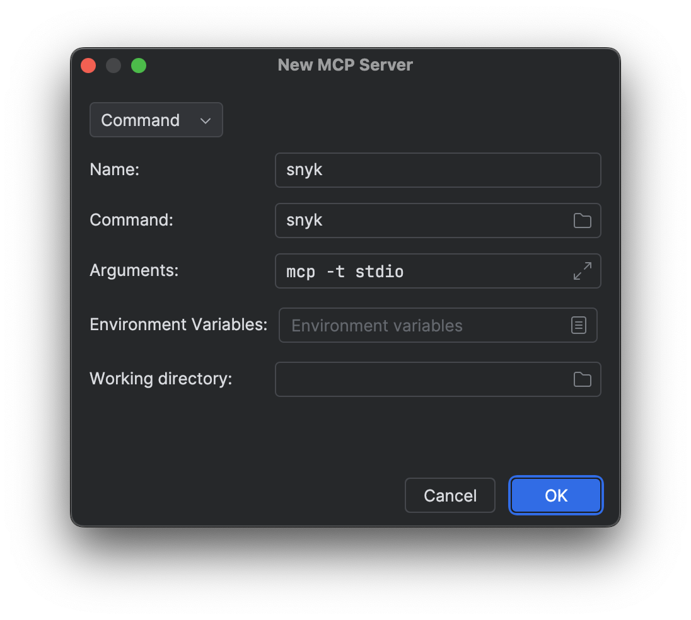
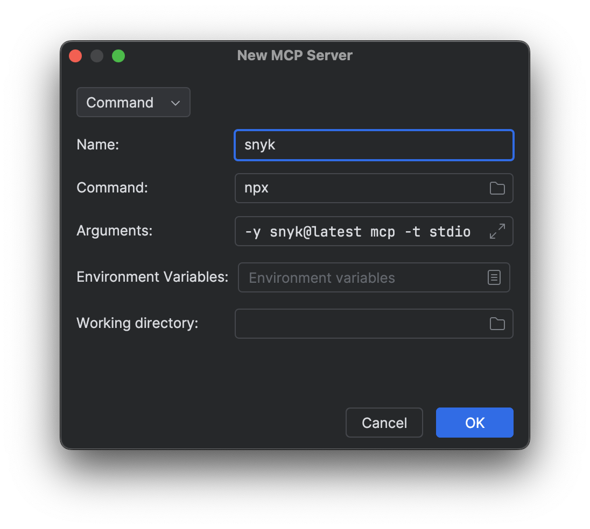
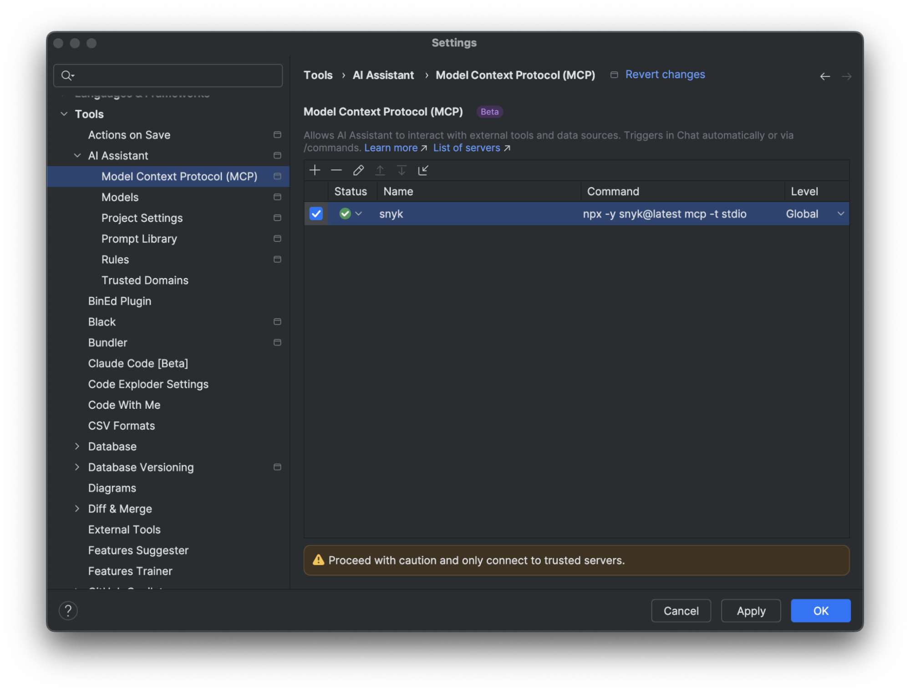

# Connect JetBrains AI Assistant to Snyk

Connect JetBrains AI Assistant to the local Snyk MCP server to scan code and dependencies from your coding assistant.


This setup provides MCP access. It does not install Studio Secure at inception hooks. Rules instruct the agent when to scan and depend on the model following those instructions.

For clients supported by the Studio CLI installer, use [Getting started with Snyk Studio](../getting-started-with-snyk-studio.md). For enterprise deployment, use the [Agentic Development Security (ADS) installer](../../evo-by-snyk/agentic-development-security-ads/activation-and-deployment/README.md).



## Prerequisites

* Install the code assistant extension
* [Install the Snyk CLI](https://docs.snyk.io/developer-tools/snyk-cli/install-the-snyk-cli)

Add the JetBrains AI Assistant plugin to your JetBrains IDE (IntelliJ IDEA, WebStorm, PyCharm, and so on). Visit the official [JetBrains AI Assistant getting started page](https://www.jetbrains.com/help/ai-assistant/getting-started-with-ai-assistant.html).

JetBrains AI Assistant tends to work more stably with the Snyk MCP service when using the [pre-installed CLI option](jetbrains-ai-assistant.md#install-the-snyk-mcp-server-in-jetbrains-ai-assistant).

## Install the Snyk MCP server in JetBrains AI Assistant

Install the Snyk MCP server using the method that best suits your operating system and local development environment.



If you have the Snyk CLI installed, open **Settings/Preferences** > **Tools** > **AI Assistant** > **Model Context Protocol (MCP)**. Edit the MCP configuration and add the following instructions:


* Specify the absolute path to the Snyk CLI executable.
* If the `snyk_trust` tool fails in JetBrains AI Assistant before a dependency scan, add `--disable-trust` to the MCP command.


If you have the Snyk CLI installed and accessible on your system path add the following command.

<figure><figcaption></figcaption></figure>

If the `snyk` command is not available, add it by following the instructions on the [Install the Snyk CLI](https://docs.snyk.io/developer-tools/snyk-cli/install-the-snyk-cli) page.

Reload the IDE window for the changes to apply.



Navigate to **Settings/Preferences** > **Tools** > **AI Assistant** > **Model Context Protocol (MCP)**.

If you have the Node.js npx executable installed in your environment, add the following command:

<figure><figcaption></figcaption></figure>


If the `snyk_trust` tool fails in JetBrains AI Assistant before a dependency scan, add `--disable-trust` to the MCP command.


Reload the IDE window for the changes to apply.



## Set up the Snyk MCP server

Verify that the Snyk MCP server is available by checking the **Status** column in the MCP configuration and requesting it to list the tools it has available.

<figure><figcaption></figcaption></figure>

\
Authenticate with Snyk and complete the client's trust request for the repository directory when prompted.

If you are already authenticated with the Snyk CLI installed on your system path, or through a prior interaction, then proceed to work with the Snyk MCP server.

## Examples

In the chat, you can tag specific files or functions and ask JetBrains AI Assistant to scan your code for safe deployment to production.


```text
Scan this project for code security & dependency vulnerabilities and security issues with snyk
```


The AI Assistant indicates that this request is related to security vulnerability scanning and calls the Snyk MCP server for various scans.
