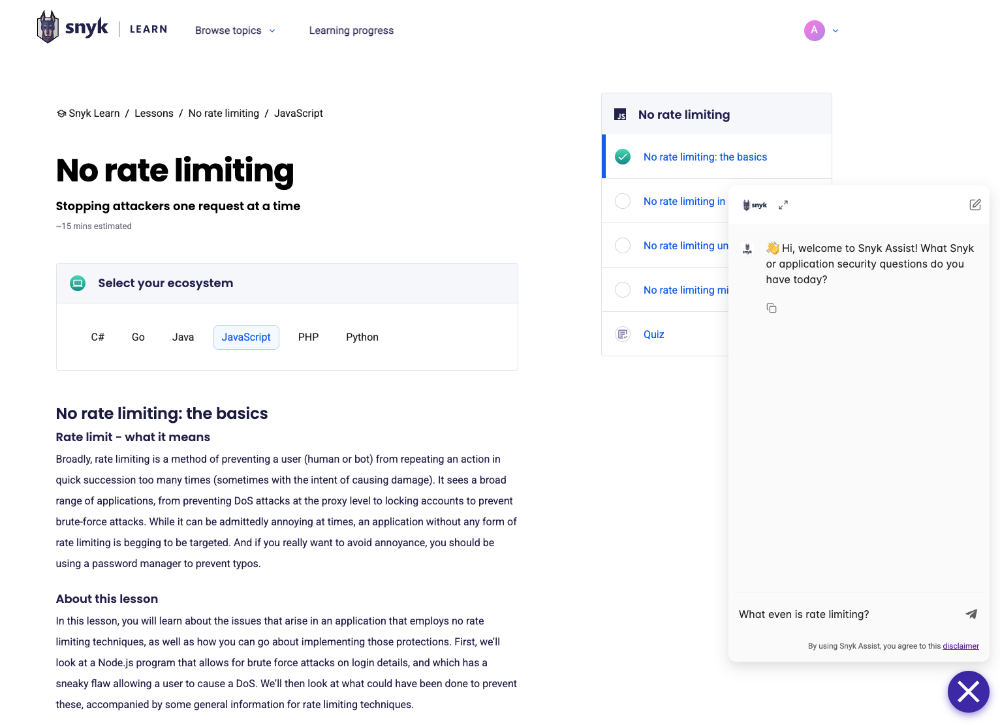
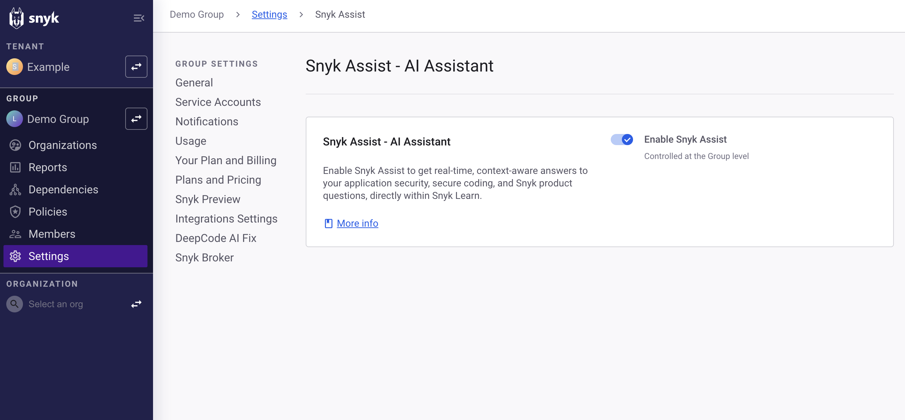

# Snyk Assist for Learn




**Feature availability**

Snyk Assist is available only in the Learning Management add-on offering. For more information, contact your Snyk account team.


Snyk Assist for Learn is an AI-powered learning assistant integrated into the Snyk Learn platform. It answers your Snyk product and application security questions instantly in your learning environment, so you can learn faster and resolve queries efficiently.

Snyk Assist enhances your learning experience in the Snyk Learn platform by:

* Providing immediate answers to questions about Snyk products, features, and general application security concepts.
* Delivering context-aware replies based on the extensive Snyk knowledge base.
* Suggesting relevant follow-on learning opportunities available in Snyk Learn, Snyk Docs, and the Snyk Blog.

<figure><figcaption>
Snyk Assist on Snyk Learn
</figcaption></figure>

## How Snyk Assist works

Snyk Assist uses generative AI to respond to questions based on information retrieved from trusted Snyk sources:

* [Snyk Learn lessons](https://learn.snyk.io/catalog/?format=lesson)
* [Snyk documentation](../../)

Snyk Assist does not have access to your Snyk Tenant data, such as issue and asset information, or Snyk Learn learning history. When you interact with Snyk Assist, Snyk collects and processes your queries and conversation history to provide responses and improve the service.

Snyk Assist uses Snyk-managed services and selected third-party large language model (LLM) providers to answer questions.


Snyk Assist capabilities and limitations:

* Snyk Assist answers questions about Snyk functionality and security concepts based on its knowledge base derived from Snyk Learn and Snyk Docs.
* Snyk Assist does not perform security analysis, check your code for vulnerabilities, comment on code quality, or provide specific code samples. For code scanning and analysis, continue using the Snyk CLI, Snyk IDE extensions, or recurring SCM tests integrated with your repositories.
* Snyk Assist provides information from its body of knowledge, but responses should not be considered legal, security, or compliance advice. While Snyk strives for accuracy, Snyk is not liable for decisions made based on information provided by Snyk Assist. Always verify critical security information through official Snyk documentation and tools.

For the usage disclaimer, visit [Snyk Assist disclaimer](https://snyk.io/policies/snyk-assist-disclaimer).


## Using Snyk Assist

Snyk Assist is available in the Snyk Learn interface for users with access to the platform, if your Snyk admin has enabled it.

1. Navigate to [Snyk Learn](https://learn.snyk.io).
2. Click the **Snyk Assist** icon  to open the chat window. The icon is in the lower-right corner of the page.
3. Type your questions about Snyk products or application security concepts into the chat prompt.

Snyk Assist answers based on its knowledge base. Answers can include links to relevant documentation, Snyk Learn lessons, and Snyk blog posts.


If you do not see the chat icon, check whether your Snyk admin has enabled Snyk Assist for your Group. Also, ensure that the default Organization in your Snyk settings is your company's Snyk Organization, not a personal Snyk Organization.


## Enabling Snyk Assist

Snyk Group Admins can control the availability of Snyk Assist for users in their scope.

To enable Snyk Assist for your Group:

1. Log in to the Snyk Web UI.
2. Navigate to the Group settings page for the Group you want to manage.
3. Toggle on **Snyk Assist** to enable Snyk Assist for users in that Group.

After you enable Snyk Assist, it is visible and accessible on Snyk Learn for the users in that Group.

<figure><figcaption>
Snyk Assist settings page
</figcaption></figure>

## Data handling and safeguards

For more information, visit [How Snyk handles your data](https://docs.snyk.io/snyk-data-and-governance/how-snyk-handles-your-data#snyk-learn).
