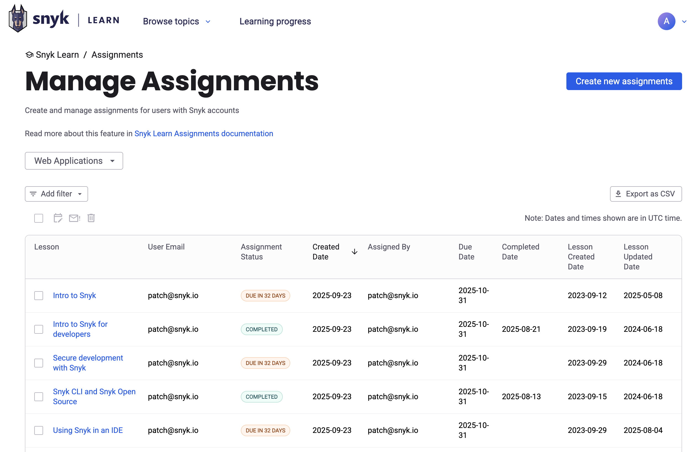
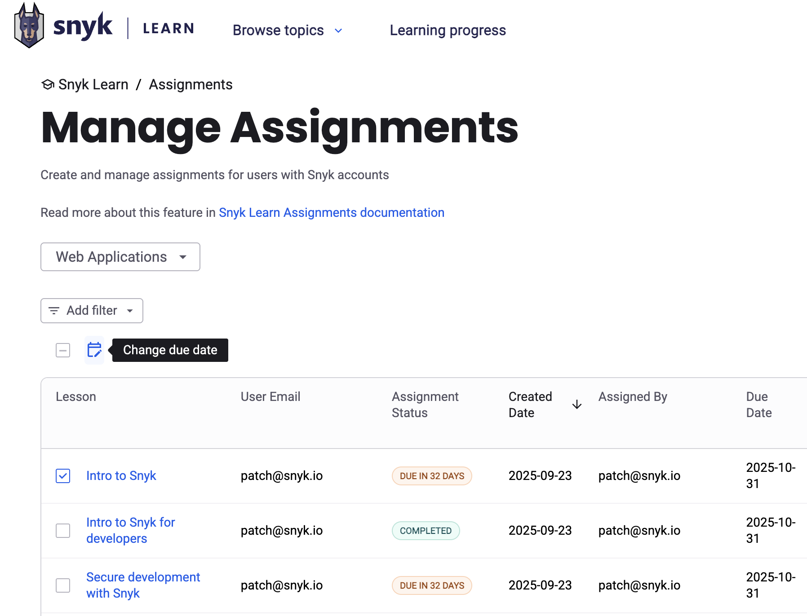
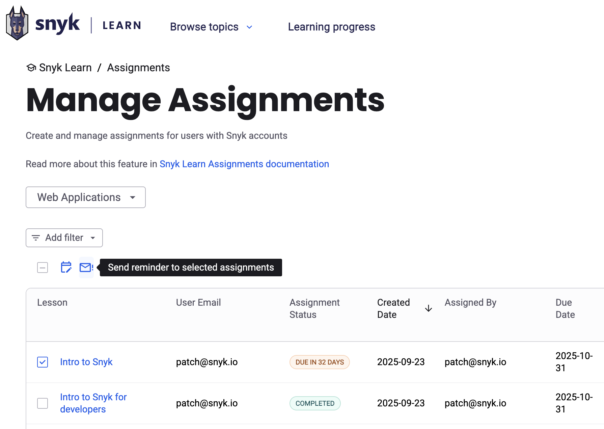

# Assignment reports




**Feature availability**

Snyk Learn assignment reporting is available only in the Learning Management add-on offering. For more information, contact your Snyk account team.


After you create your first [assignments](../snyk-learn-assignments.md) in Snyk Learn, you can use Assignment reporting to track progress at the Organization level. This is useful for team managers, security champions, AppSec engineers, and compliance team members to follow up on detailed progress and to extract reports for compliance usage.

Navigate to your [assignment](https://learn.snyk.io/admin/assignments/) dashboard to find reports that show the progress of your Organization against assignments.

Use the filter to drill down further. Use the buttons under the filter to change the due date, delete assignments, and send email reminders to your users.

<figure><figcaption></figcaption></figure>

## Changing the due date

Select the assignments whose due date you want to change, then click the icon highlighted in the following image. When prompted, pick a new date. Snyk Learn updates the due date and the Learning Progress dashboard of each user.

<figure><figcaption></figcaption></figure>

## Sending a reminder email

Select an assignment, then click the highlighted button to send a reminder email. Before Snyk Learn sends the reminder, you can add a custom message.

<figure><figcaption></figcaption></figure>
