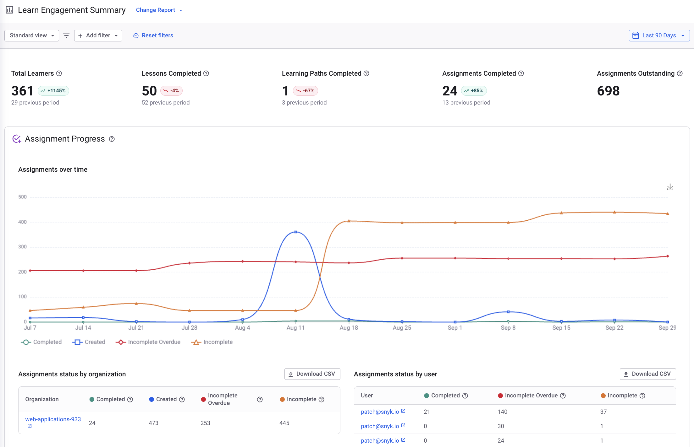
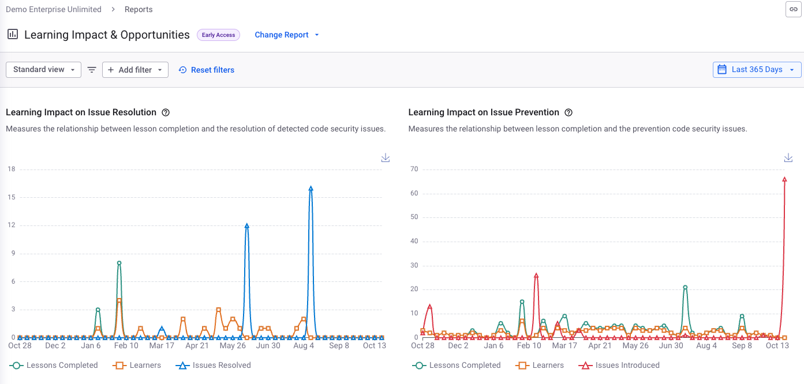
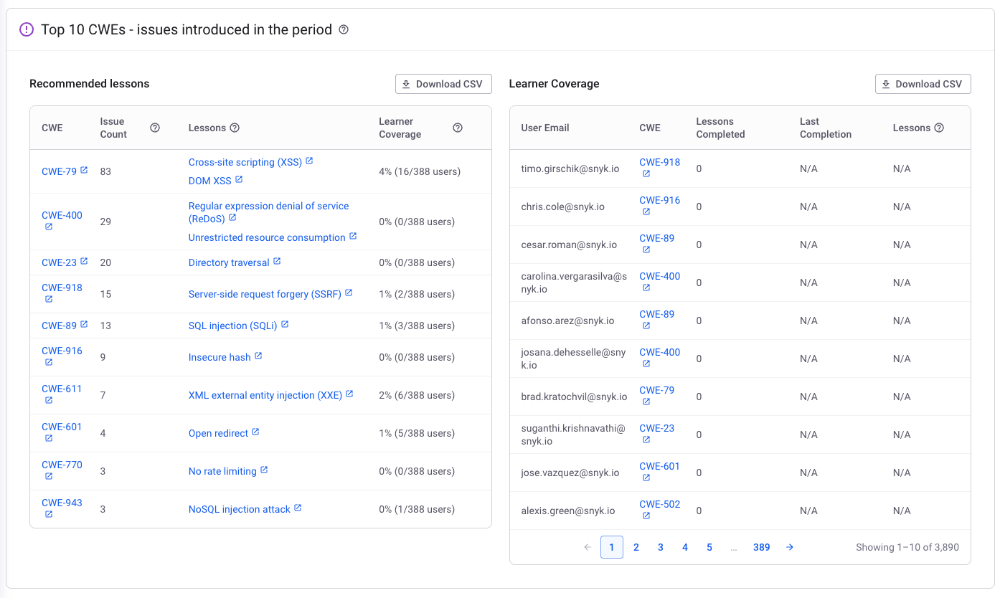
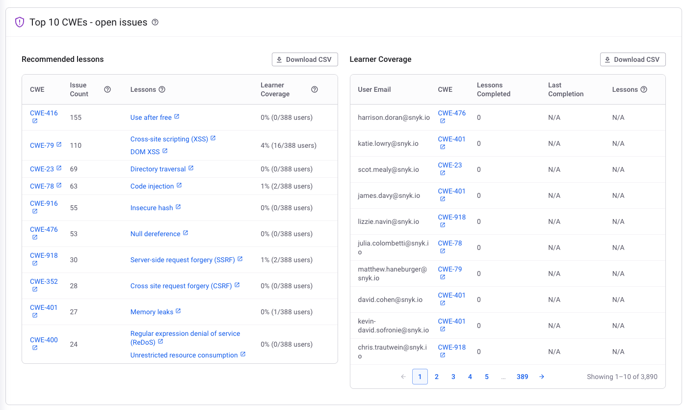

# Program reporting




**Feature availability**

Snyk Learn program reporting is available only in the Learning Management add-on offering. For more information, contact your Snyk account team.


Snyk Learn provides reports, powered by Snyk in-app reporting, that give you insights into your security training and education program.

## Learn engagement report

The engagement report provides insights into the overall progress of your security education and training programs and shows which parts of your Organization engage with Snyk Learn content. Use the data and insights to optimize your program, find security champions, generate reports for compliance, and show progress to your executive sponsors. This report is available at the Group level.

For details, visit the [Learn Engagement section of Education reports](https://docs.snyk.io/scan-fix-and-prevent/prevent/analytics/reports-tab/education-reports#learn-engagement).


The engagement report does not include [learning programs](../snyk-learn-learning-programs.md).


<figure><figcaption></figcaption></figure>

## Learning Impact and Opportunities report


The Learning Impact and Opportunities report is available in Early Access.


The Learning Impact and Opportunities report shows the impact your security education and training programs have on code issue remediation and prevention. In addition, the report gives recommendations for future training based on your code issue backlog and issues that were introduced during the selected time period of the report. This report is available at the Group level.

For details, visit the [Learning Impact and Opportunities section of Education reports](https://docs.snyk.io/scan-fix-and-prevent/prevent/analytics/reports-tab/education-reports#learning-impact-and-opportunities).

<figure><figcaption></figcaption></figure>

<figure><figcaption></figcaption></figure> <figure><figcaption></figcaption></figure>

