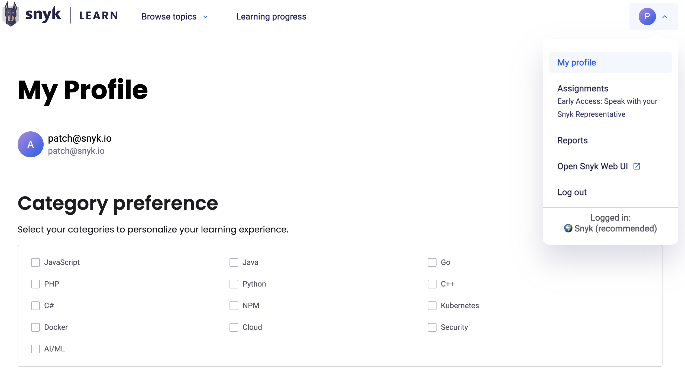
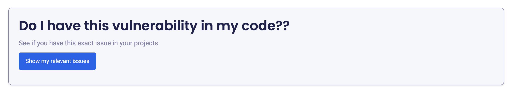

# Your learning



## Finding learning opportunities

You can see all of the lessons and learning paths available at [https://learn.snyk.io/catalog/](https://learn.snyk.io/catalog/). You can search or use the filters to help find learning opportunities that are relevant to your interests and needs. The catalog covers common application security topics and product training for Snyk. For developers, Snyk recommends starting with the [OWASP Top 10 learning path](https://learn.snyk.io/learning-paths/owasp-top-10/).


When a lesson related to an issue exists, the issue details in the Snyk Web UI, in IDE integrations, and in pull requests include a link to it in Snyk Learn.


When you are logged in to Snyk Learn, you can also filter by status to see learning that is in progress or already complete.

You can specify categories of learning on your profile to improve learning recommendations.

## Your profile

In your profile, you can set your learning preferences, including the preferred language.

<figure><figcaption>
Snyk Learn My Profile
</figcaption></figure>

## In-progress learning

The [Learning Progress](https://learn.snyk.io/user/learning-progress/) area lets you see your in-progress learning and start where you left off. You also receive recommendations for what to learn next.

## Vulnerabilities in your code


**Feature availability**

"Vulnerabilities in your code" is available in the Learning Management add-on offering. For more information, contact your Snyk account team.


When viewing a security education lesson, authenticated users can see a **Do I have this vulnerability in my code??** section. This shows real Snyk Code vulnerabilities from your preferred Organization that match the lesson topic, based on CWE identifiers.

For each matching Project, you can see:

* The Project name, origin, and branch
* Issue counts by severity (critical, high, medium, low)
* Up to three matching issues with direct links to fix them in the Snyk platform

This requires active Snyk Code Projects in your preferred Organization.

<figure><figcaption></figcaption></figure>

## Assigned learning


**Feature availability**

Assignments are available in the Snyk Learning Management add-on offering. For more information, contact your Snyk account team.


Learning assigned to you appears on the [Learning Progress](https://learn.snyk.io/user/learning-progress/) page and includes the due date, if one is set.

## Assessments

Some Snyk Learn lessons include a quiz at the end to test your knowledge. You must be logged in and complete the quiz to mark the course as completed.

## Certificates of completion

When you complete any Snyk Learn security learning path, you receive a certificate of completion. The certificate recognizes your time and effort to improve your security skills and knowledge. You can download a PDF of the certificate from the learning path page.
