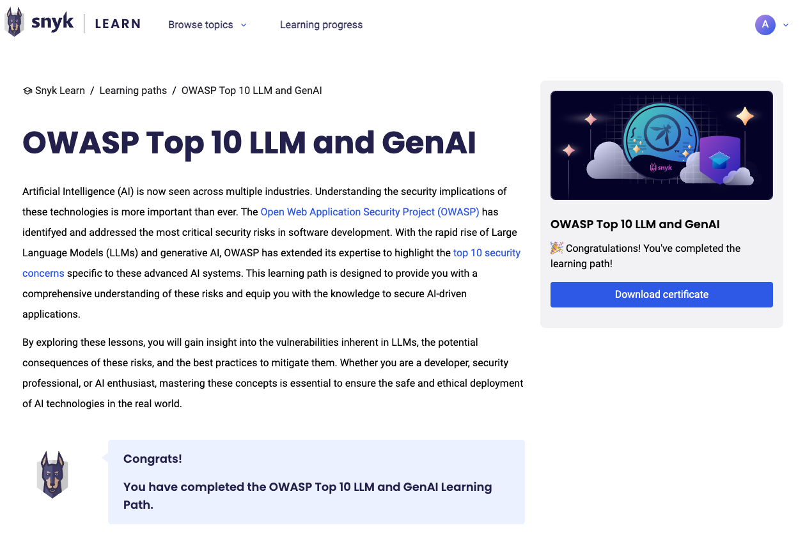
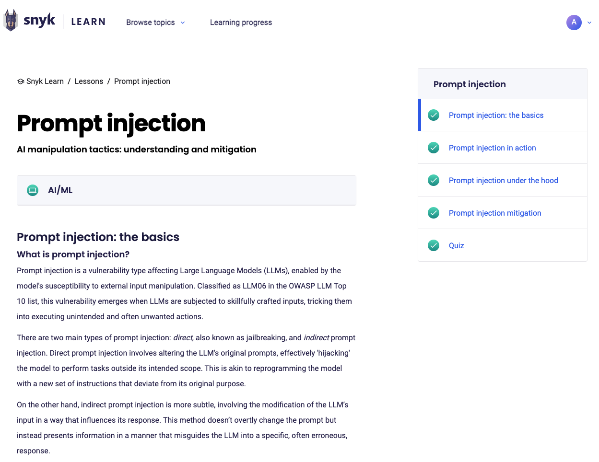

# Claiming CPE credits with Snyk Learn



Snyk Learn offers a range of security education lessons and learning paths designed to enhance your application security skills. While these lessons provide valuable knowledge, they do not automatically grant Continuing Professional Education (CPE) credits. To claim CPE credits for your participation in Snyk Learn lessons and learning paths, follow these steps.


The process for claiming CPE credits can vary depending on your certifying organization.


1. Complete a Snyk Learn module.
   1. Log in to your Snyk Learn account and finish a lesson or learning path.
   2. Ensure you meet all completion criteria, such as passing the quiz and engaging with interactive content.
2. Document your learning activity. Record essential details of the completed module, including:
   * Course title
   * Provider name: Snyk
   * Completion date
   * Duration: time spent on the module
3. Submit to your certification body.
   1. Access the CPE submission portal of your certifying organization, such as ISC2 or ISACA.
   2. Enter the recorded details and provide any required documentation, such as completion certificates (available for learning paths) or screenshots of the completed lesson in your Learning Progress dashboard or the lesson page. The following sections show examples.
4. Provide additional information if requested. If your certifying body asks for further details or sends inquiries to verify your CPE claim, respond to them.

## Learning path certificate example

Navigate to the page for the learning path that you completed and click **Download certificate**.

<figure><figcaption>
A completed Learning Path with certificate
</figcaption></figure>

## Lesson completion example

<figure><figcaption></figcaption></figure>
