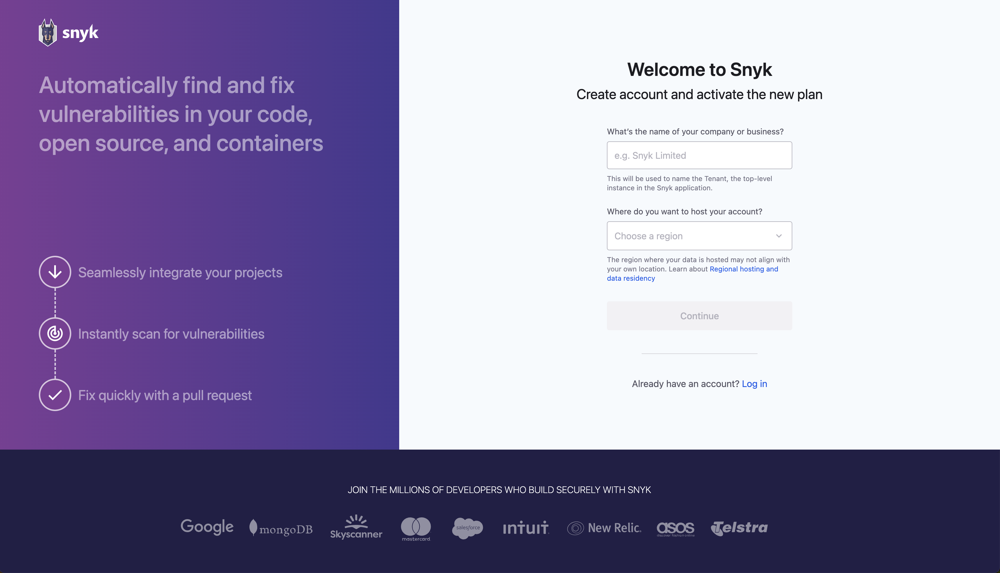
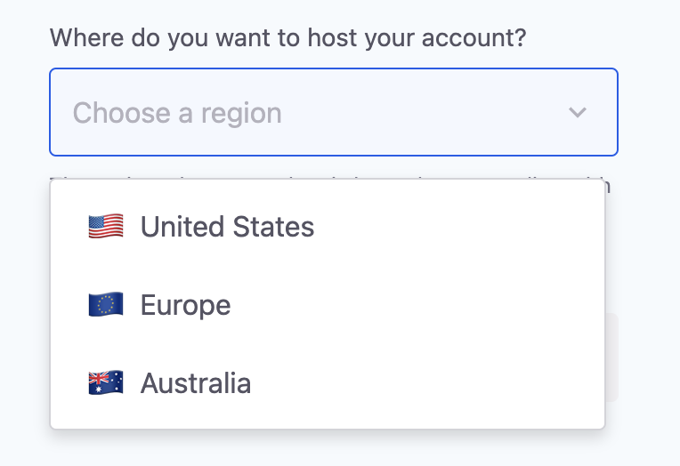
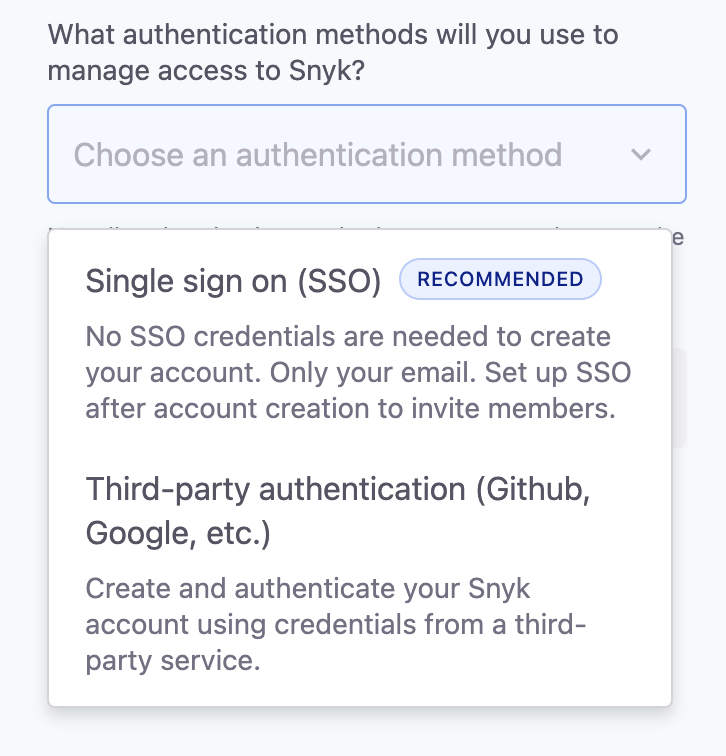
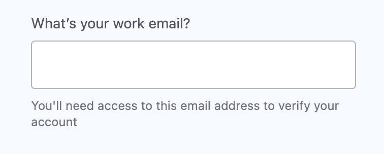
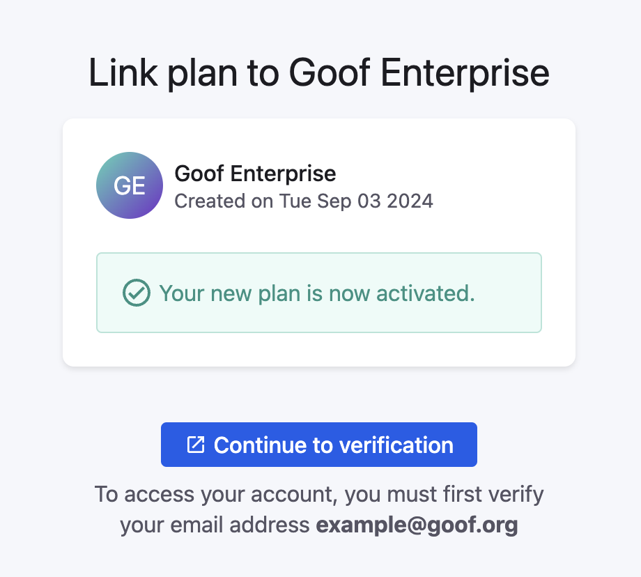
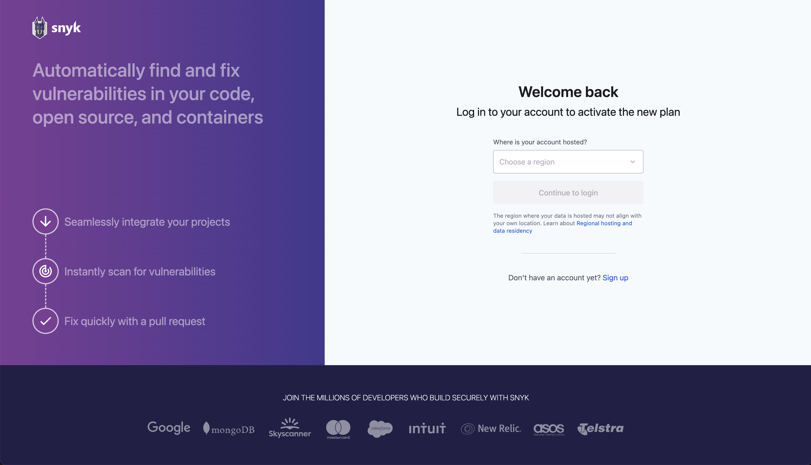
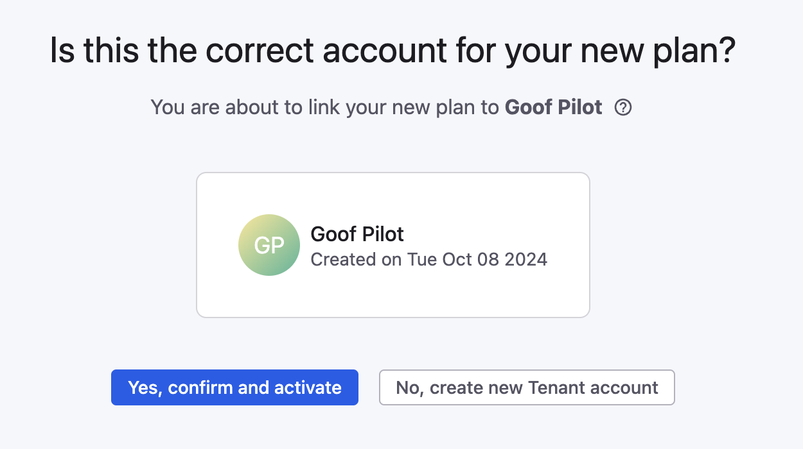
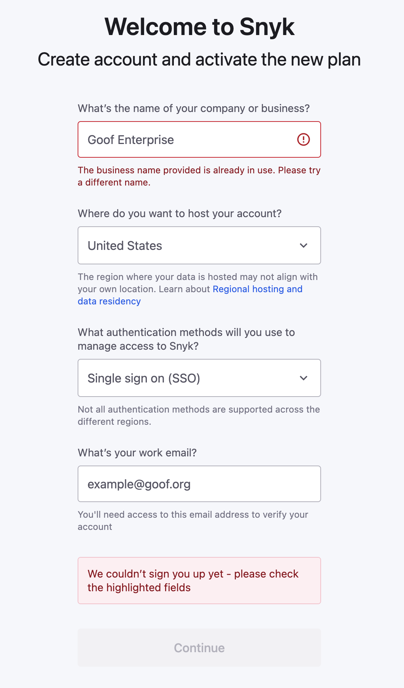
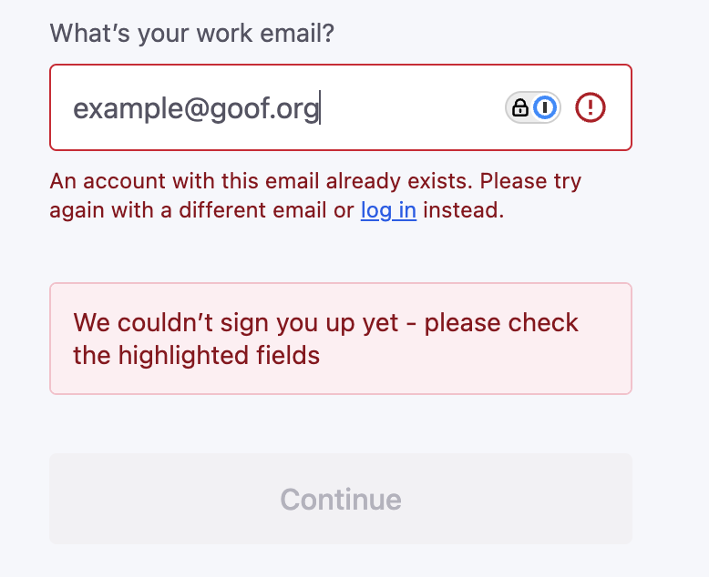
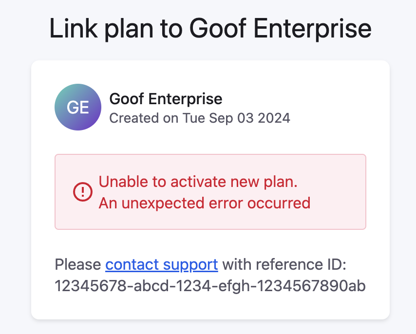

# Auto-provisioning guide


**Feature availability**

Auto-provisioning is available only for customers starting a Pilot or Enterprise plan.


Provisioning is your first interaction with Snyk, before you get access. You answer the following questions about how you plan to use the platform:

* What is the name of your business?
* Where do you want your data to be hosted?
* Which authentication method do your users use to access Snyk?
* Do you already have a Snyk account you want to use (a previously completed Pilot), or do you want to start from scratch?

This guide covers the following aspects of automated provisioning:

1. [Prerequisites](auto-provisioning-guide.md#prerequisite-the-welcome-to-snyk-email)
2. [New account sign-up](auto-provisioning-guide.md#sign-up-start-from-scratch)
3. [Existing account sign-up](auto-provisioning-guide.md#logging-in-provision-using-an-existing-user-account)
4. [Error types and solutions](auto-provisioning-guide.md#error-types-and-solutions)

## Prerequisite: the "Welcome to Snyk" email

You receive an email with links to start provisioning. Search your inbox for an email from no-reply@snyk.io with the subject "Welcome to Snyk".

If you have not received this email, check your spam folder or contact your account executive.

This email contains two links:

1. **Log in and activate your existing account**: Use this link if you already have an account and want to apply your plan to it.
2. **Create and activate a new account**: Use this link if you are new to Snyk or want to start from scratch with a different user.


After provisioning is complete, these links become invalid, and an **Access denied** error page appears.

If you have not completed provisioning but still see this error, ensure that no one else in your company has already completed the flow. The welcome email can have more than one recipient.


## Sign up - start from scratch

The **Create and activate a new account** link in your welcome email takes you to the sign-up page in the provisioning app.


You can access the provisioning app only through a unique link. All other access is disabled and shows an error page.


<figure><figcaption>
Sign up page on provision.snyk.io
</figcaption></figure>

### Step 1: Enter the company name

Snyk uses the company name you enter here to create the [Tenant](https://docs.snyk.io/platform-administration/snyk-hierarchy/tenant), the top-level instance you see in the Snyk platform. This field is required and has a 60-character limit.

Provisioning also creates a [Group](https://docs.snyk.io/platform-administration/snyk-hierarchy/groups) and a default [Organization](https://docs.snyk.io/platform-administration/snyk-hierarchy/organizations) using the same name.


Choose this name carefully. It sets the Group and Organization URL slugs, and the Group slug is used in your SAML Entity ID if you later configure single sign-on (SSO). Changing the display name afterward does not change the URL slug or the internal name used by the Snyk CLI. To change a slug, you must raise a Snyk Support ticket.


### Step 2: Choose where to host the account

<figure><figcaption>
Available hosting regions
</figcaption></figure>

Snyk offers [regional hosting](https://docs.snyk.io/snyk-data-and-governance/regional-hosting-and-data-residency) to comply with regional data protection laws and improve service performance. Regional hosting helps you meet data residency requirements and reduces data latency.

Provisioning is enabled for these [three regions](https://docs.snyk.io/snyk-data-and-governance/regional-hosting-and-data-residency#available-snyk-regions). Each of these regions runs at least one instance of the Snyk platform:

* :flag\_us: United States: SNYK-US-01, SNYK-US-02
* :flag\_eu: Europe: SNYK-EU-01
* :flag\_au: Australia: SNYK-AU-01

If [multiple instances](https://docs.snyk.io/snyk-data-and-governance/regional-hosting-and-data-residency#regional-multi-and-single-tenant-hosting) are available in the chosen region (United States), Snyk reserves the right to choose the specific instance where it creates your account. For more information, visit [Regional hosting and data residency](https://docs.snyk.io/snyk-data-and-governance/regional-hosting-and-data-residency).

If you select the United States region and use SSO for authentication, your account is provisioned on SNYK-US-02. Use https://app.us.snyk.io to access Snyk and https://api.us.snyk.io for CLI and IDE integrations. For the full list of regional endpoints, visit [Regional hosting and data residency](https://docs.snyk.io/snyk-data-and-governance/regional-hosting-and-data-residency).


Automated provisioning is possible only for multi-tenant environments. For single-tenant availability (Snyk Private Cloud), contact your account team before provisioning.


### Step 3: Select an authentication method

<figure><figcaption>
Available authentication methods
</figcaption></figure>

The available authentication methods are SSO and third-party authentication.

* **Single Sign-On**: Use the existing identity management system of your company. For more details, visit [Single Sign-On (SSO) for authentication to Snyk](https://docs.snyk.io/platform-administration/user-management/single-sign-on-sso-for-authentication-to-snyk).
* **Third-party authentication**: Snyk supports a list of third-party identity providers. For more details, visit [Authentication for third-party tools](https://docs.snyk.io/developer-tools/authentication-for-third-party-tools). This method is available only for the United States region.

The following table shows which authentication methods are available in each region:

| Region                   | Single Sign-On       | Third-party providers      |
| ------------------------ | -------------------- | -------------------------- |
| :flag\_us: United States | :heavy\_check\_mark: | :heavy\_check\_mark:       |
| :flag\_eu: Europe        | :heavy\_check\_mark: | :heavy\_multiplication\_x: |
| :flag\_au: Australia     | :heavy\_check\_mark: | :heavy\_multiplication\_x: |

Snyk recommends selecting SSO because it is the best supported option across all environments. When you select this option, Snyk prompts you to enter a valid, work-issued email address, which Snyk uses to create an initial Snyk Admin user. You do not need any extra SSO configuration at this point.

<figure><figcaption>
Email address input
</figcaption></figure>

### Step 4: Confirm details and start provisioning

As a final step, confirm that the details you entered are correct.

* If you selected SSO as the authentication method, click **Sign up**. A loading page appears while Snyk completes the background work.
* If you selected third-party authentication, click **Continue to sign up options**. Snyk redirects you to the Snyk login page, where you can choose your identity provider (GitHub, Google, and so on). After you complete sign-up, Snyk redirects you back to the provisioning app, where a loading page shows the background work in progress.

Snyk recommends that you do not close the page. If you close it, you risk not seeing the process complete successfully.

### Step 5: Access the Snyk platform

If you selected SSO as the authentication method, a success message and a verification button appear after plan activation is done. Snyk also sends an email that confirms successful provisioning and contains the same login verification link. This link does not expire, and you can use it for multiple authentications if needed.

After you click the link, Snyk sends a login code to the email address you entered earlier. This is known as passwordless login. Enter the code where prompted, and you are ready to start using Snyk.

<figure><figcaption>
Successful provisioning for SSO
</figcaption></figure>

If you selected **Third-party authentication**, you are ready after plan activation is done. Click **Continue to your account** and start using the platform.


If the start date of your contract is in the future, your plan might not have all features enabled. You gain full access to all features on the start date.


## Logging in - provision using an existing user account

The **Log in and activate your existing account** link in your welcome email takes you to the login page in the provisioning app.

### Step 1: Log in

If your user account is connected through a third-party provider, you must use SNYK-US-01.

You can find the links for all the regions in the [Login and Web UI URLs section](https://docs.snyk.io/snyk-data-and-governance/regional-hosting-and-data-residency#login-and-web-ui-urls).

<figure><figcaption>
Log in page on provision.snyk.io
</figcaption></figure>

### Step 2: Select an existing Tenant or start fresh

<figure><figcaption>
Linking to an existing Tenant or creating a new one
</figcaption></figure>

If you already have a Snyk user, you can choose how you activate your Enterprise plan or Pilot after you log in:

* Linking the plan to an existing [Tenant](https://docs.snyk.io/platform-administration/snyk-hierarchy/tenant).\
  If your user is a member of multiple Tenants, you can choose between them. Click the card of the Tenant you want, and then click **Confirm and activate**.
* Starting fresh with a new [Tenant](https://docs.snyk.io/platform-administration/snyk-hierarchy/tenant) linked to your user.\
  Click **Create new Tenant account** and enter the company name. It is the same field as in [#step-1-enter-the-company-name](auto-provisioning-guide.md#step-1-enter-the-company-name "mention") of the sign-up flow. Snyk asks you to confirm the name you entered before starting the provisioning process.

### Step 3: Access the Snyk platform

This step is the same as [#step-5-access-the-snyk-platform](auto-provisioning-guide.md#step-5-access-the-snyk-platform "mention") when signing up. After the process is done, click **Continue to your account** and begin using Snyk.


If the start date of your contract is in the future, your plan might not have all features enabled. You gain full access to all features on the start date.


## Error types and solutions

### Validation errors

When you create a new Tenant or user, Snyk checks for duplicates and surfaces any errors.

* **The business name provided is already in use.** — Use a different name. If you want to link your plan to that existing Tenant but you are not a member of it, contact your account executive.

<figure><figcaption>
Business name already in use error
</figcaption></figure>

* **An account with this email already exists.** — Use a different work email address, or log in ([#logging-in-provision-using-an-existing-user-account](auto-provisioning-guide.md#logging-in-provision-using-an-existing-user-account "mention")), and then create the new Tenant.

<figure><figcaption>
User with the same email address already exists error
</figcaption></figure>

### Plan activation errors

If you see this screen, save the **reference ID**. Send it to your account executive, or contact Snyk Support with the reference ID and the steps you took.

<figure><figcaption>
Plan activation error
</figcaption></figure>
