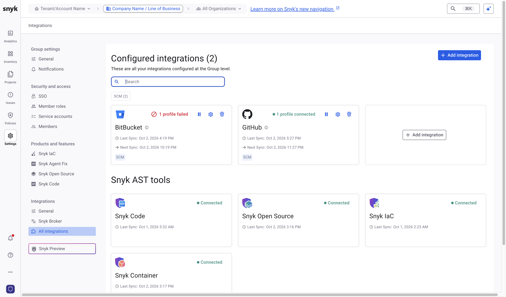
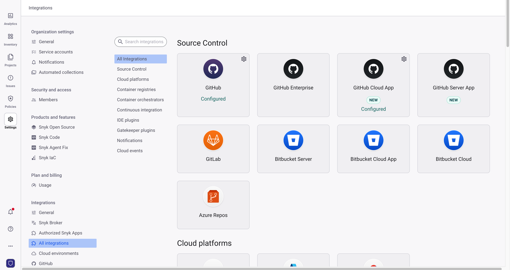

# Bitbucket



Configure the Bitbucket integration at both the Group level and the Organization level. For more details about setting up the Bitbucket integration, contact your Snyk account team.

## Generate a Bitbucket API token

Bitbucket Cloud uses API tokens instead of app passwords. In Bitbucket, navigate to **Atlassian account settings** > **Security** > **Create and manage API tokens**, and create an API token with the following scopes:

* `read:account`
* `read:user:bitbucket`
* `read:workspace:bitbucket`
* `read:project:bitbucket`
* `read:repository:bitbucket` and `write:repository:bitbucket`
* `read:pullrequest:bitbucket` and `write:pullrequest:bitbucket`
* `read:webhook:bitbucket` and `write:webhook:bitbucket`

For what each scope is used for, visit [Bitbucket permission requirements](https://docs.snyk.io/developer-tools/integrations/scm-integrations/user-permissions-and-access-scopes#bitbucket-permission-requirements).


Save the API token and the email address of your Atlassian account. You need both for the Group-level integration and the Organization-level integration.


## Configure the Group-level integration

1. In the Snyk Web UI, use the scope selector at the top of the page to switch to your Group.
2. Navigate to **Settings** > **Integrations** > **All integrations**, then click **Add integration**.

<figure><figcaption></figcaption></figure>

3. Search for and select the Bitbucket integration.
4. Complete all mandatory fields, including your Atlassian account email and the API token. For more details, visit [Integrate Bitbucket using Snyk Essentials](https://docs.snyk.io/developer-tools/integrations/scm-integrations/group-level-integrations/bitbucket-for-snyk-essentials).
5. Optional: include the Backstage catalog. For details, visit [Backstage file for SCM integrations](https://docs.snyk.io/developer-tools/integrations/scm-integrations/application-context-for-scm-integrations#backstage-file-for-scm-integrations).


After you configure the integration, the Group-level integration shows a **Partially connected** status. During the next synchronization, the integration moves to the connected state, and Snyk fills the Inventory with data from Bitbucket.


## Configure the Organization-level integration

1. In the scope selector, open the **Organization** dropdown and select your Organization.
2. Navigate to **Settings** > **Integrations** > **All integrations**.
3. Search for and select the Bitbucket integration.
4. Complete all mandatory fields, including your Atlassian account email and the API token. For more details, visit [Bitbucket integration settings](https://docs.snyk.io/developer-tools/integrations/scm-integrations/organization-level-integrations/bitbucket-cloud).

<figure><figcaption></figcaption></figure>

The Organization-level integration is available immediately, so you can import repositories and start scanning.
