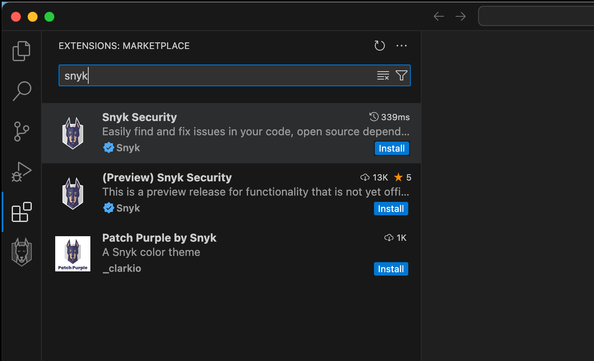

# Local scanning with the IDE



## Configure the Snyk IDE

To start scanning code in the IDE, navigate to your IDE plugin or extension marketplace and search for Snyk. This page focuses on VS Code, but the [other supported IDEs](https://docs.snyk.io/developer-tools/integrations/snyk-ide-plugins-and-extensions) follow a similar setup flow.

1. In VS Code, open **Extensions** and search for Snyk.
2. Install the Snyk extension.

<figure><figcaption></figcaption></figure>

3. Select **Connect & Trust Workspace** to let Snyk scan your code.
4. After Snyk redirects you, click **Grant app access**. This authenticates your Snyk IDE extension.
5. Return to your IDE, where you can start scanning immediately.

## Use the Snyk IDE

### Read the results

The extension groups results by scan type: Open Source issues first, followed by Code, then Infrastructure as Code.

### Filter issues

You can filter issues in several ways to tune what the extension shows you while coding. Two of the most common settings to adjust are **Severity** and **Total vs. new**.

To adjust which severity is shown, navigate to the **Severity** section in the extension settings.

You can also switch from viewing all issues in the codebase to only new issues. This method scans the main branch and the version that the developer is working on, then reports only the new vulnerabilities. Toggle this mode at the top of the extension menu.

This option helps developers avoid introducing new vulnerabilities without getting overwhelmed by their backlog.

### Check the vulnerabilities

The results for each scan type and vulnerability type vary, but expect to see inline feedback and a more detailed window that opens when you click the vulnerability.

For Snyk Code issues, you can see the Fix Analysis, Data Flow, and an Issue Overview. You can also click **Learn about this issue type** to open a more detailed lesson in the Snyk developer education platform, [Snyk Learn](https://learn.snyk.io/).

The next step in the guide covers fixing issues.


Additional resources

* [Product Training: Snyk in the IDE](https://learn.snyk.io/lesson/snyk-in-an-ide)
* [Snyk Docs: Snyk IDE plugins and extensions](https://docs.snyk.io/developer-tools/integrations/snyk-ide-plugins-and-extensions)
* [Troubleshooting](https://docs.snyk.io/developer-tools/integrations/snyk-ide-plugins-and-extensions/troubleshooting-ides)

