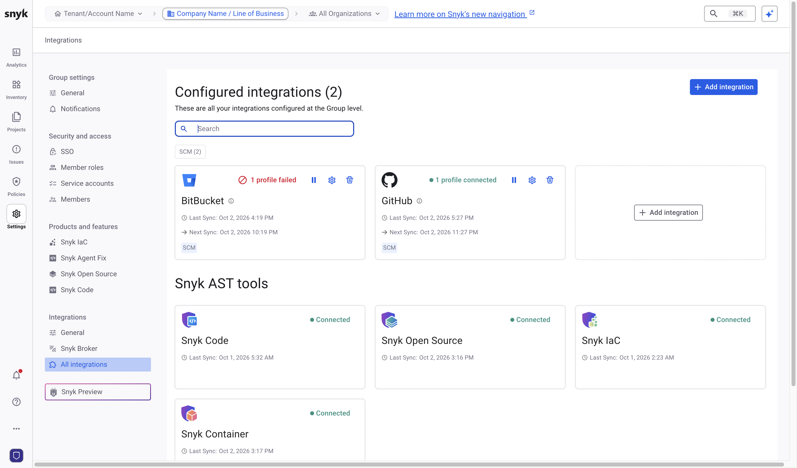
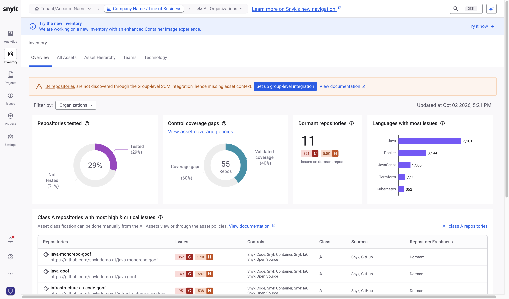

# Review scan coverage



## Check the Group-level SCM integration

Ensure that the Group-level SCM integration is configured.

1. In the Snyk Web UI, use the scope selector at the top of the page to switch to your Group.
2. Navigate to **Settings** > **Integrations** > **All integrations** and find your SCM.
3. Follow the instructions for your SCM.

<figure><figcaption></figcaption></figure>

## Review coverage in the Inventory

At Group scope, select **Inventory** in the side menu. The **Overview** tab shows your most important repositories and identifies coverage gaps: which repositories Snyk has tested and which it has not. For details, visit [Manage assets](https://docs.snyk.io/scan-fix-and-prevent/fix/manage-assets).

<figure><figcaption></figcaption></figure>

The **All Assets** tab lists every repository, with the number of issues, the Snyk tests that have run, tags ingested from the SCM, contributing developers, and repository freshness.

<figure><figcaption></figcaption></figure>

To view the repositories that a Snyk product has not tested, click the **Not tested** section of the first chart on the **Overview** tab, or use the coverage filters on the **All Assets** tab.

## Classify assets

The **Class** column is available for each repository. The class reflects the business criticality of the asset, from A (most critical) to D (least critical). Try manually setting a few of your most important repos to Class A. You can use this attribute in reporting to focus on issues from the most important repositories in your company.

You can set the class manually, or you can create a policy to classify repositories automatically. For example, Snyk ingests metadata such as GitHub Topics and Custom Properties that you can use in a policy.

For example, a policy can filter on all repositories that have a compliance tag, which in this case comes from the GitHub Custom Property, and set the asset class to A.

Use the asset class to filter on the most critical repositories in your company, and to take a risk-based approach to prioritization that accounts for business impact. The asset class can be used when reviewing scan coverage and in all available Snyk reports.


Additional resources

* [Manage assets](https://docs.snyk.io/scan-fix-and-prevent/fix/manage-assets)
* [Product Training: Snyk Essentials](https://learn.snyk.io/catalog/?type=product-training\&topics=Snyk+Essentials)

