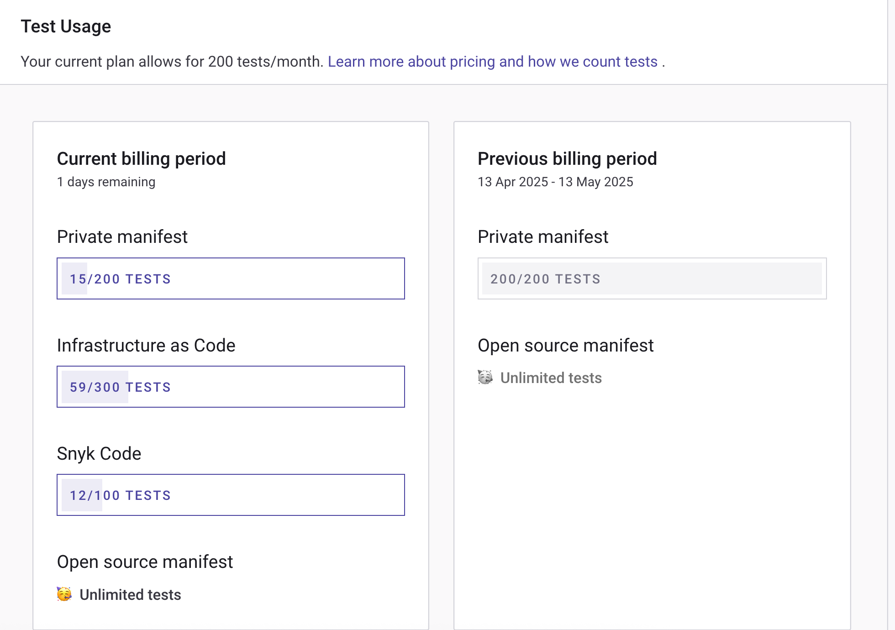

# SKU-based licensing usage settings


The following usage settings are relevant only for subscriptions to the legacy, SKU-based licensing offerings for Snyk Open Source, Snyk Code, Snyk Container, and Snyk IaC. These settings do not apply to any capabilities entitled through the [Snyk Platform Subscription](../snyk-platform-subscription-mechanics.md).


In your Group or Organization, navigate to **Settings** > **Usage** to view Snyk usage details for your Group or Organization:

* **Test usage**: the number of tests used
* **Contributing developers**: the number of developers contributing to Projects


For more information about test frequency settings, visit [Project actions](https://docs.snyk.io/scan-fix-and-prevent/scan-with-snyk/snyk-projects#project-actions-on-the-project-listing-page) on the Project Listings page, which also explains bulk actions.


## Test usage

The **Test Usage** section shows how many tests you are using over the current billing period:

<figure><figcaption>
Test usage data
</figcaption></figure>


Test limits vary for Snyk products and plans.

For the Free plan, the limits are 400 tests for Open Source, 100 tests for Code, 300 tests for IaC, and 100 tests for Container.

To see the limits that apply to you and how much of them you have used, open **Usage** in your Organization settings. On an Enterprise plan, your contract sets your limits, and Snyk does not publish them here. Your Snyk account team can confirm them. For more details, visit [Plans and pricing](https://snyk.io/plans/). For details of how Snyk counts tests, visit [What counts as a test?](https://docs.snyk.io/snyk-data-and-governance/what-counts-as-a-test)


## Contributing developers

Snyk defines contributing developers as developers who made a commit in the last 90 days to a private Git repo that Snyk monitors.

The **Contributing developers for SCM and CLI integrations** section shows contributing developer counts, both at the Organization level and the Group level.

The developer count is the number of developers who have contributed to the default branch of any private repository connected to an integration.

Snyk does not count contributions to public (open-source) repos because the pricing model is based on the number of contributing developers to private repositories.

The contributing developers count shows:

* **Total unique contributors across all integrations**: the number of contributors across all the integrations in your Snyk account. Snyk counts each contributing developer only once, even if they have contributed to multiple integrations or multiple repositories.
* **Breakdown by integration**: the number of contributors, Organizations, and repos in that integration.

Snyk identifies a contributor by the author email field in their local Git settings.
