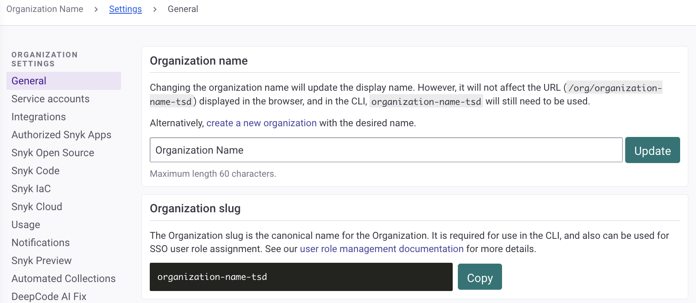
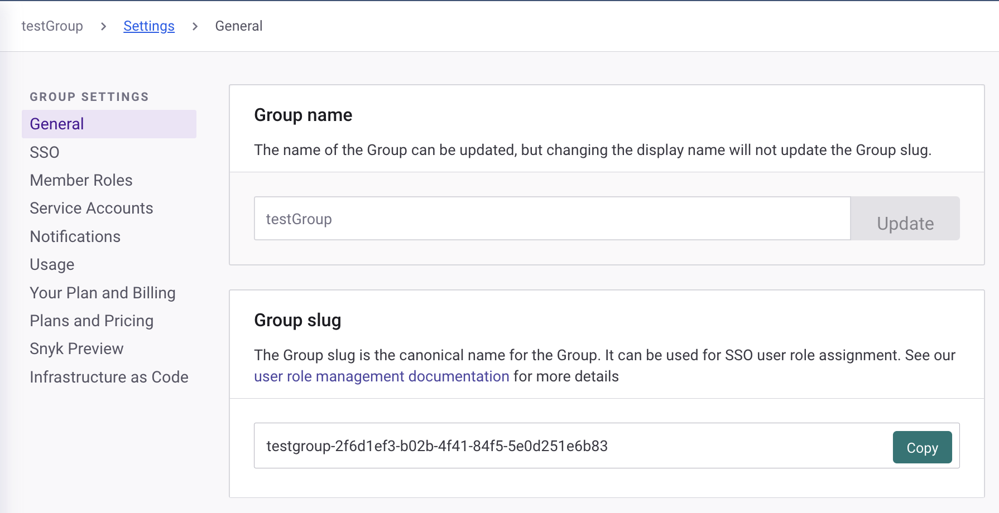
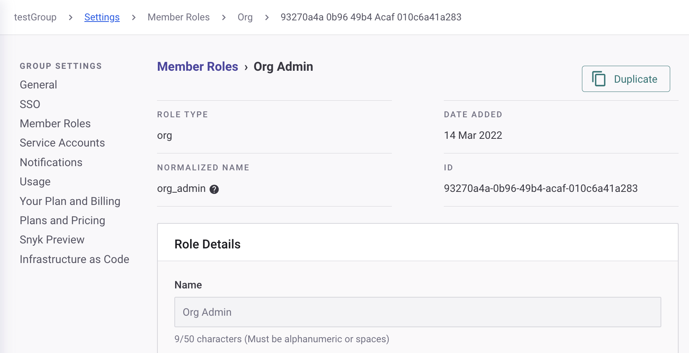

# Custom mapping



Custom mapping assigns users to your Snyk Tenants, Groups, and Organizations from role data your Identity Provider (IdP) sends at login. Use it when you need scaled provisioning with roles that differ by user, rather than a single default role for every SSO user.

To understand roles and permissions within Snyk, visit [Pre-defined roles](../../pre-defined-roles.md) and [User role management](../../user-role-management.md).

## Prerequisites

Self-serve SSO does not support custom mapping. Your Snyk account team or Snyk Support completes the Snyk side of the SSO setup. For details, visit [Choose a provisioning option](../choose-a-provisioning-option.md#custom-mapping).

Complete the following before you request custom mapping for your SSO connection:

* Complete the SSO information worksheet for your IdP in [Resources for SSO setup](../set-up-snyk-single-sign-on-sso.md#resources-for-sso-setup).
* Configure your IdP to send an attribute named exactly `roles`. The attribute name is case-sensitive, so `role` and `Roles` do not match.
* Configure each role value in the `snyk:{scope}:{target}:{role}` format, and match the case exactly. The `snyk:` prefix, the scope (`org`, `group`, or `tenant`), and the target slug are case-sensitive. For the full format, visit [Role assertion format](./#role-assertion-format).
* Use Organization and Group [slugs](./#slugs), not display names or IDs, as targets.
* Create any custom roles in Snyk before you map them. Use the [role normalized name](./#role-normalized-name) with a `custom:` prefix in the assertion.

When your IdP is ready, contact your Snyk account team or open a support case with [Snyk Support](https://support.snyk.io) to turn on custom mapping for the SSO connection. Until Snyk turns it on, Snyk ignores the roles claim from your IdP. As part of the case, Snyk Support validates your claims against the role assertion format. For the activation sequence, visit [Step 5: Test pre-production activation](migrating-from-legacy-to-v2-custom-mapping.md#step-5-test-pre-production-activation).


After Snyk turns on custom mapping, Snyk applies roles the next time each user logs in. A user without a valid mapping loses access at that login.


## Custom mapping options

Snyk offers an updated custom mapping option explained on this page, with increased flexibility, including the ability to grant users Group-level and Tenant-level custom roles, in addition to pre-defined roles.

If you use the legacy format, visit [Migrating from legacy to v2 custom mapping](migrating-from-legacy-to-v2-custom-mapping.md).

The Snyk [Legacy custom mapping](legacy-custom-mapping.md) option is still supported.

## Roles array mapping with Snyk

In the IdP, pass a custom mapping called `roles` as a string array. For setup steps in specific IdPs, visit [Examples: Setting up custom mapping for IdPs](examples-setting-up-custom-mapping-for-idps/).

Refer to your identity provider documentation for further information on how to configure custom mappings.

## Custom mapping assertions

This section documents the role assertions that Snyk expects in order to map correctly to Snyk roles within Snyk Tenants, Groups, and Organizations.

### Role assertion format

Role assertions must use the following format:

`snyk:{scope}:{target}:{role}`

Where:

* `snyk` is a fixed prefix for role mapping. **Required**.
* `scope` can be one of `org`, `group`, or `tenant`. **Required**. If a role mapping does not contain a valid scope, Snyk ignores it.
* `target` can be a slug of an `org`, `group`, or `tenant` where the role will be granted. See [slugs](./#slugs) for more information.
  * **Optional**. Use an asterisk `*` or an empty string `::` to apply as a [wildcard](./#wildcards) for all resources within the defined `scope` that are associated with the SSO connection.
* `role` is the normalized name of the required role. **Required**. If no role is present, Snyk ignores the role mapping. To find the normalized name, visit [Role normalized name](./#role-normalized-name).
  * If the role is a custom role, that is, a role created in the Group Member Roles admin panel that can be of either `Org` or `Group` type, then it must have a `custom:` prefix. See the [example role assertions](./#example-role-assertions).
  * Built-in roles do not have the `custom:` prefix, so values like `org_admin`, `org_collaborator`, and `group_viewer` refer to the Snyk pre-defined roles, which are shown with a padlock symbol in the Member Roles page.


Users must have only one role mapped per Organization, Group, or Tenant. Mapping multiple roles except when using wildcards is not supported and can lead to unexpected behavior.


### Default role assignments

All users with any memberships within a Tenant must have a Tenant membership. If a user has a membership of an Organization, they must also have a Group membership.

If your IdP sends only an Organization-level role assertion for a user, Snyk automatically assigns the **Tenant Member** and **Group Member** roles. You can override these automatic assignments by providing role assertions at the Group or Tenant level.

Snyk recommends providing explicit Tenant-level and Group-level role assertions where needed, so that users have the correct role on login.


An SSO connection is associated with only one Tenant, and all users with any memberships within a Tenant must also have a Tenant membership.

Therefore, it may be easier to assign Tenant-level roles by using the wildcard syntax (see example below), since the SSO is only linked to the one Tenant.


### Example role assertions

* `snyk:group:*:group_admin` assigns the user the Group Admin role for all Groups associated with the SSO connection.
* `snyk:group::custom:sysadmin` assigns the user the custom Group-level role Sys Admin for all Groups associated with the SSO connection.
  * Note that `::` here indicates an empty string for the target, and so is treated as a wildcard in the preceding example.
  * Note that this Group-level custom role must be created manually before it can be assigned.
* `snyk:org:my-default-org:org_admin` assigns the user the **Organization Admin** Organization-level role for the Organization with slug `my-default-org`.
* `snyk:tenant::tenant_admin` assigns the user the **Tenant Admin** Tenant-level role for the Tenant associated with the SSO connection.

### Example role assertions array

An example of a set of role assertions for a user follows:

```json
{
  "roles": [
    "snyk:group:*:group_viewer",
    "snyk:org:development:org_admin",
    "snyk:org:test-org-N58YhztauHcaMiNfvi5fbL:custom:developer_readonly"
  ]
}
```


The system also supports comma-separated lists of roles instead of an array.

```json
{
  "roles": "snyk:group:*:group_viewer, snyk:org:development:org_admin, snyk:org:test-org-N58YhztauHcaMiNfvi5fbL:custom:developer_readonly"
}
```


These assertions assign the user:

* The pre-defined Group-level role **Group Viewer** for all Groups in the SSO. For the permissions this role grants, visit [Pre-defined roles](../../pre-defined-roles.md).
* The pre-defined Organization-level role **Organization Admin** for the Organization with the slug `development`.
* The custom Organization-level role **Developer ReadOnly** for the Organization with the slug `test-org-N58YhztauHcaMiNfvi5fbL`.

## Wildcards

Custom mapping introduces wildcards, which allow one assertion to assign a user the same role in all Organizations or Groups.

Assertions using wildcards take a lower priority than assertions with a specific target. This means that it is possible, for example, to assign a user a default role for all Organizations, and specific roles in others:

```json
{
  "roles": [
    "snyk:org:*:custom:developer_readonly",
    "snyk:org:development:org_admin"
  ]
}
```

These role assertions will:

* Grant the user the pre-defined Organization-level role **Organization Admin** in the Organization with the slug `development`.
* Grant the user the custom Organization-level role **Developer ReadOnly** on all other Organizations within the SSO connection.
* Grant the user the pre-defined Group-level role **Group Member** on all Groups in the SSO connection. For more details, see the note that follows.


When a user has a role in an Organization within the SSO and the role assertion has no explicit Group-level role, Snyk also assigns the user the **Group Member** Group-level role for that Group. This is the pre-defined Group-level role with the fewest permissions and ensures that the user becomes a member of the Group.


## Slugs

For a valid role assertion, the Organization or Group slug may be required, where a wildcard is not used. The slug is the canonical name for the Organization or Group within Snyk.

To find an Organization slug, navigate to the **Settings** page for the Organization. Under **General** settings, the Organization slug value is visible. Copy it and use it in role assertions in custom mapping.

<figure><figcaption><p>Organization general settings page, showing the Organization slug</p></figcaption></figure>

To find the slug of a Group, navigate to the Group Settings, and find the Group slug under General Settings, which you can copy.

<figure><figcaption><p>Group general settings page, showing the Group slug</p></figcaption></figure>

## Role normalized name

To find the normalized name of a role for use in custom mapping, first confirm that the role exists for the Snyk Group by navigating to it in the Group settings: **Group Settings** > **Member Roles** > {**Role**}.

This opens the role details page that shows which permissions are enabled for the role and also shows the normalized name. Copy this normalized name and use it in custom mapping.

For more details on roles, and specifically custom roles, visit [User role management](../../user-role-management.md).

<figure><figcaption><p>Role details page for Organization Admin role</p></figcaption></figure>

## Pre-defined role slugs

Snyk has a set of [pre-defined roles](../../pre-defined-roles.md). Their corresponding normalized names are listed below.

| Role Type    | Role Name        | Role Slug          |
| ------------ | ---------------- | ------------------ |
| Organization | Org Admin        | `org_admin`        |
| Organization | Org Collaborator | `org_collaborator` |
| Group        | Group Admin      | `group_admin`      |
| Group        | Group Viewer     | `group_viewer`     |
| Group        | Group Member     | `group_member`     |
| Tenant       | Tenant Admin                  | `tenant_admin`                  |
| Tenant       | Tenant Viewer                 | `tenant_viewer`                 |
| Tenant       | Tenant Viewer with Evo access | `tenant_viewer_with_evo_access` |
| Tenant       | Tenant Member                 | `tenant_member`                 |
| Tenant       | Tenant Member with Evo access | `tenant_member_with_evo_access` |

## Troubleshooting

Use this table when role mapping does not match what you expect after setup.

| Symptom | Cause | Fix |
| --- | --- | --- |
| Snyk ignores all roles from the IdP | Custom mapping is not turned on for the SSO connection | Contact your Snyk account team or open a support case with [Snyk Support](https://support.snyk.io) to turn on custom mapping. Until then, Snyk ignores the roles claim. |
| The roles attribute does not arrive, or arrives as `role` or `Roles` | The IdP sends the attribute under a different name. The name must be exactly `roles` | Rename the IdP attribute or claim to `roles`. Confirm the SAML or OIDC payload includes that claim. |
| Snyk ignores a role string | Missing `snyk:` prefix, invalid scope, missing role, or a Group role written with an Organization scope (or the reverse) | Use `snyk:{scope}:{target}:{role}` with scope `org`, `group`, or `tenant`, and a role that exists for that scope. For details, visit [Role assertion format](./#role-assertion-format). |
| The target does not match | An IdP group name or a display name was used instead of the slug, or the slug casing does not match | Use the Organization or Group [slug](./#slugs) exactly as shown in Snyk settings. |
| A custom role is not applied | Missing `custom:` prefix, or the role does not exist in Snyk yet | Create the custom role first, then map `snyk:{scope}:{target}:custom:{normalized_name}` using the [role normalized name](./#role-normalized-name). |
| Existing users still have their old roles | Snyk updates roles only at the next login | Ask affected users to log out and log in again through SSO. |
| Users lost access after activation | The IdP sends no valid role assertion for those users | Add valid role assertions for those users in the IdP, then ask them to log in again through SSO. To prevent this, check every mapping before activation, as described in [Prerequisites](./#prerequisites). |
| A user gets unexpected roles | More than one role mapped for the same Organization, Group, or Tenant without a wildcard | Map only one role per Organization, Group, or Tenant. Use wildcards for a baseline role and specific targets for exceptions. |

If you still cannot resolve the problem, open a support case with [Snyk Support](https://support.snyk.io) and include:

* the name of your Snyk Group or Tenant, your IdP, and the approximate time of a failed login
* the IdP attribute name and a redacted sample of the roles claim values for one affected user
* the Organization or Group slugs and role normalized names you expect to match
* whether Snyk confirmed that custom mapping is turned on for the connection
