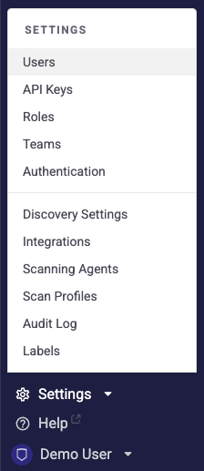

# Add users


For Snyk-managed accounts, you add users in Snyk, not here, and there is no **Add User** button. A user appears in Snyk API & Web the first time they log in. For details, visit [Understand Snyk-managed accounts](snyk-managed-accounts.md).


## Add a user to your account

To add users to your account:

1. Open the **Settings** dropdown menu on the bottom-left corner of the navigation bar.

<figure></figure>

2. Select **Users**.
1. Click **Add User**.
1. Enter the following information for your team member:
   * Name
   * Email
   * Title
1. Configure the intended Role and Scope.
1. Optionally, set up Labels to help you filter users later.
1. Click **Add**.

You can repeat this process to continue adding colleagues to Snyk API & Web.
