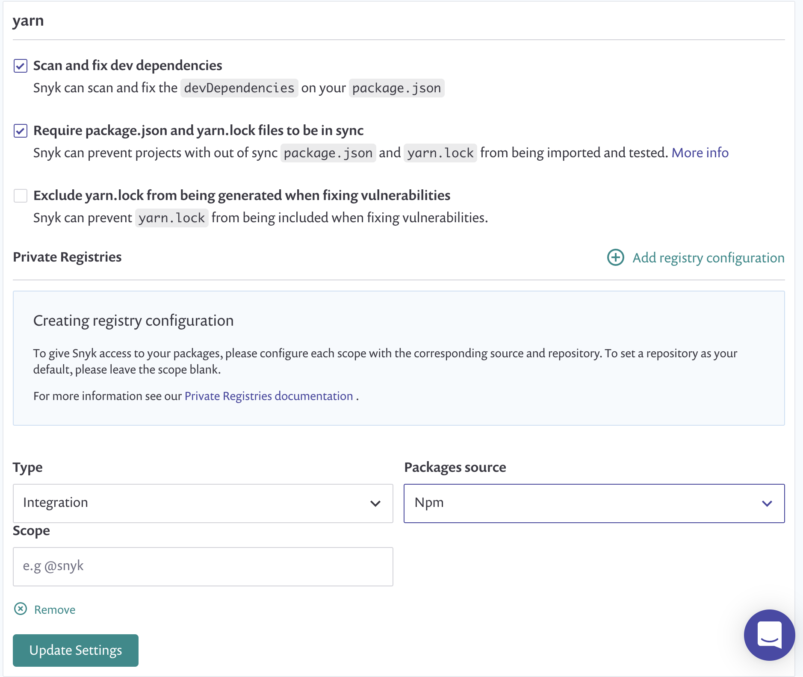
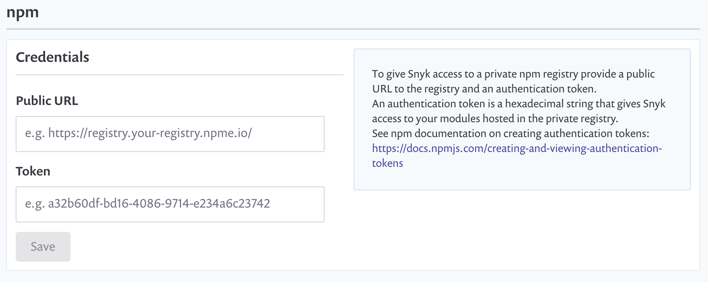



# npm Teams and npm Enterprise integration

Snyk can use custom npm Teams and npm Enterprise repositories, and Azure Artifacts npm feeds, with npm and Yarn Projects.


**Feature availability**\
This feature is available only with Enterprise plans. For more information, see [plans and pricing](https://snyk.io/plans/).

This guide is relevant for Snyk Web UI integrations only. The Snyk CLI already supports Yarn and npm projects with private npm Teams and npm Enterprise registries.


Snyk uses this integration when it creates fix pull requests and merge requests. npm and Yarn use the registry to reach your private dependencies and regenerate the lockfile.

Snyk does not use the integration to scan. Snyk reads your dependencies from the lockfile, so private packages listed in the lockfile appear in scan results. For a Project without a lockfile, Snyk resolves dependencies from the public npm registry and cannot resolve packages that exist only in your private registry.

You can add configuration to tell Snyk where your private npm Teams and npm Enterprise Node.js packages are hosted and under what scope.

This is the same information you would normally add in your `.yarnrc` or `.npmrc`

## JavaScript language settings

1. Navigate to **Settings** > **Languages** > **JavaScript** and either the npm or Yarn settings, depending on your Project type. Yarn is shown in the screenshot.
2. If you have not previously connected to npm Teams or npm Enterprise, you will be asked to configure an integration first. See [npm Teams and npm Enterprise registry settings](npm-teams-and-npm-enterprise-integration.md#npm-teams-and-npm-enterprise-registry-settings).
3. After you have set up the integration, select **Add registry configuration.**
   1. Select **npm** as the **Package source**.
   2. If you want to configure this registry as the default registry url, leave the scope blank.
   3. If you want to configure only scoped packages to use this registry, add a scope.
   4. If you want to add a mix of default registry url and scoped packages, add multiple configurations, one for the default and one per scope.
4. When you have added all the registries and scopes you want, click **Update settings**.
5. To test the integration, open a Pull/Merge Request on a Project that contains private dependencies to see a lockfile updated and included in the Snyk Fix Pull Request where previously none was generated.

<figure><figcaption><p>Test of npm integration</p></figcaption></figure>

## npm Teams and npm Enterprise registry settings

You can configure token-based authentication for npm Teams and npm Enterprise integrations.

### Token requirements

For the public npm registry (`https://registry.npmjs.org`), use an npm granular access token. npm no longer supports classic tokens. For details, see [About access tokens](https://docs.npmjs.com/about-access-tokens/) in the npm documentation. Create the token with the following settings:

* Packages and scopes: **Read-only** access to every private package or scope that your Projects depend on. For packages owned by an npm organization, select the organization's scope, for example `@your-org`. Snyk does not need write access.
* Organizations: **No access**. This setting only covers managing the organization. Package access comes from **Packages and scopes**.
* Expiration: choose a date that suits your rotation policy. After the token expires, Snyk can no longer use it to reach your registry. Update the token in the integration before it expires.

To check the token before you add it to Snyk, run the following commands.

The first command checks that the token authenticates, which is what the Snyk connection check verifies. Confirm that it returns your npm username, for example `{"username":"your-npm-user"}`:

```bash
curl -s -H "Authorization: Bearer <your-token>" \
  https://registry.npmjs.org/-/whoami
```

The second command checks that the token can read a private package. Confirm that it returns `200`:

```bash
curl -s -o /dev/null -w "%{http_code}\n" \
  -H "Authorization: Bearer <your-token>" \
  https://registry.npmjs.org/<your-private-package>
```

For a scoped package, encode the slash in the package name, for example `@your-scope%2fyour-package`.

### Configure the credentials

1. Navigate to **Settings > Integrations > Package Repositories > npm.**\
   You should see the **Credentials** screen at the beginning.
2. Enter **Public URL** and **Token** values.
3. Click **Save**.

<figure><figcaption><p>npm credentials screen</p></figcaption></figure>

## Azure Artifacts npm feeds

Snyk does not have a separate Azure Artifacts integration for npm. Use the npm integration with your Azure Artifacts feed URL and a personal access token (PAT).

1. In Azure DevOps, create a PAT with the **Packaging** > **Read** scope.
2. In Snyk, navigate to **Settings** > **Integrations** > **Package Repositories** > **npm**.
3. Enter the feed registry URL as the **Public URL**. The URL ends with `/npm/registry/`, for example:
   * Project-scoped feed: `https://pkgs.dev.azure.com/`_your-organization_`/`_your-project_`/_packaging/`_your-feed_`/npm/registry/`
   * Organization-scoped feed: `https://pkgs.dev.azure.com/`_your-organization_`/_packaging/`_your-feed_`/npm/registry/`
4. Enter the PAT as the **Token**. Enter the PAT itself, not a base64-encoded value.
5. Click **Save**.
6. Add the feed as a registry in the [JavaScript language settings](npm-teams-and-npm-enterprise-integration.md#javascript-language-settings).

You can copy the feed URL from **Connect to feed** > **npm** in Azure Artifacts.
